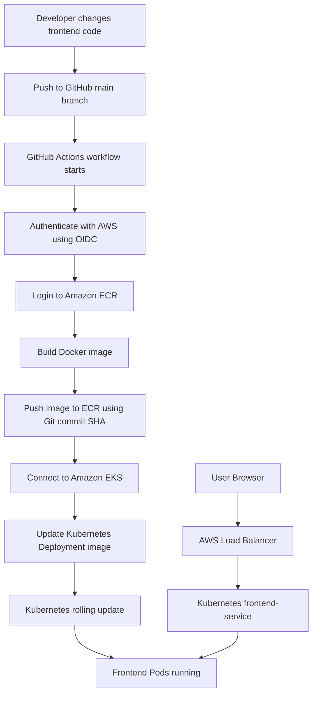

Hello This Is Ankush
# AWS CI/CD Pipeline using GitHub Actions, Docker, Amazon ECR and Amazon EKS

## 1. Project Overview

This project implements an automated CI/CD pipeline for deploying a frontend application to Amazon EKS.

Whenever frontend code is updated and pushed to the main branch:
1. GitHub Actions automatically starts the pipeline.
2. GitHub Actions authenticates with AWS using OIDC.
3. Docker builds a new frontend image.
4. The image is pushed to Amazon ECR.
5. GitHub Actions connects to the Amazon EKS cluster.
6. The Kubernetes Deployment is updated with the new image.
7. Kubernetes performs the rollout and replaces the old Pods.

The GitHub repository is maintained as the source of truth for the project.

## 2. Architecture Flow


```

3. AWS Resources Used
Resource	Name / Configuration	Purpose
AWS Region	ap-south-1	AWS region used for this project
ECR Repository	ankush-frontend	Stores Docker images
EKS Cluster	ankush-cluster	Runs the Kubernetes application
Node Group	frontend-nodes	Provides worker nodes
Instance Type	t3.small	Worker node instance type
Kubernetes Namespace	frontend	Separates frontend resources
Deployment	frontend-deployment	Manages frontend Pods
Container	frontend-container	Container inside the Deployment
Service	frontend-service	Exposes frontend using LoadBalancer

4. Repository Structure
CI-CD/
├── .github/
│   └── workflows/
│       └── deploy.yml
├── frontend/
│   ├── Dockerfile
│   ├── index.html
│   ├── frontend-deployment.yaml
│   └── frontend-service.yaml
├── infra/
│   └── cluster.yaml
└── readme.md

5. Technologies Used
- Git and GitHub – Source code management
- GitHub Actions – CI/CD automation
- Docker – Containerization
- Amazon ECR – Docker image registry
- Amazon EKS – Managed Kubernetes service
- Kubernetes – Container orchestration
- AWS IAM – Identity and access management
- AWS OIDC – Secure authentication from GitHub Actions
- kubectl – Kubernetes command-line tool
- eksctl – EKS cluster management
6. CI/CD Workflow
Workflow file: .github/workflows/deploy.yml
Workflow triggers
The pipeline runs when:
- Code under frontend/** is pushed to the main branch.
- .github/workflows/deploy.yml is changed and pushed to main.
- The workflow is started manually using workflow_dispatch.
Changes only under infra/ do not trigger the configured push workflow.
Pipeline steps
1. Checkout repository – Downloads the latest source code.
2. Configure AWS credentials – Assumes the AWS IAM role using GitHub OIDC.
3. Login to Amazon ECR – Authenticates Docker with the ECR registry.
4. Build and push Docker image – Builds the frontend image and pushes it to ECR.
5. Install kubectl – Installs kubectl on the GitHub Actions runner.
6. Connect to EKS – Updates kubeconfig for ankush-cluster.
7. Update Deployment – Updates the image of frontend-container in frontend-deployment.
8. Verify rollout – Waits for the Kubernetes Deployment rollout to complete.

Docker image tagging
The workflow uses the Git commit SHA as the image tag.

Image format:
967618591568.dkr.ecr.ap-south-1.amazonaws.com/ankush-frontend:<commit-sha>


This connects each deployed image to the Git commit that produced it.
7. AWS Authentication Using OIDC
GitHub Actions uses OpenID Connect (OIDC) to authenticate with AWS.

Implemented IAM resources:
- GitHub OIDC provider: token.actions.githubusercontent.com
- IAM role: GitHubActionsEKSDeployRole
- IAM policy: GitHubActionsEKSDeployPolicy
The role trust policy restricts access to the repository and main branch:
repo:3cloudy/CI-CD:ref:refs/heads/main


An EKS access entry was created for the GitHub Actions role, with AmazonEKSEditPolicy associated at the frontend namespace scope.

The workflow uses temporary AWS credentials through OIDC instead of storing permanent AWS access keys in GitHub Secrets.
8. Kubernetes Deployment
The application runs in the frontend namespace.

Important Kubernetes resources:
- Deployment: frontend-deployment
- Container: frontend-container
- Service: frontend-service
- Service type: LoadBalancer
- Service port: 80
The Deployment maintains the frontend replicas. The LoadBalancer Service exposes the frontend application externally.
9. Useful Verification Commands
Check EKS clusters:
aws eks list-clusters --region ap-south-1


Check Kubernetes nodes:
kubectl get nodes


Check frontend Pods:
kubectl get pods -n frontend


Check Deployment:
kubectl get deployment -n frontend


Check Service and LoadBalancer:
kubectl get svc -n frontend


Check rollout:
kubectl rollout status deployment/frontend-deployment -n frontend


Check ECR images:
aws ecr describe-images \
  --repository-name ankush-frontend \
  --region ap-south-1


10. Testing Performed
The following validations were performed during implementation:
- EKS cluster reached ACTIVE status.
- Managed worker nodes were created.
- VPC CNI, CoreDNS and kube-proxy became operational.
- Frontend Pods reached Running state.
- Frontend Service created an AWS Load Balancer.
- HTTP request to the Load Balancer returned HTTP 200.
- Frontend application was accessible through the Load Balancer DNS.
- A frontend code change triggered GitHub Actions automatically.
- The new Docker image was pushed to ECR.
- Kubernetes Deployment was updated automatically.
- The updated frontend application was successfully deployed.
11. Project Cleanup
The AWS resources created for this project can be removed when the project is no longer running.

Important: The GitHub repository 3cloudy/CI-CD is the project source code and should be retained.

AWS cleanup should be performed carefully, including:
- EKS managed node group and cluster
- Kubernetes LoadBalancer and associated resources
- ECR repository and images
- Project-specific IAM role and policy
- Project-specific OIDC providers, only after checking dependencies
Do not delete shared AWS resources or IAM resources used by other projects.
12. Final Project Summary
This project demonstrates an automated frontend deployment pipeline using GitHub Actions, Docker, Amazon ECR and Amazon EKS.

A developer pushes frontend code to GitHub. GitHub Actions builds and publishes a Docker image, authenticates securely with AWS through OIDC, updates the Kubernetes Deployment and waits for the rollout to complete.

The project helped demonstrate practical experience with source control, containerization, AWS services, Kubernetes deployments, IAM permissions and CI/CD automation.
